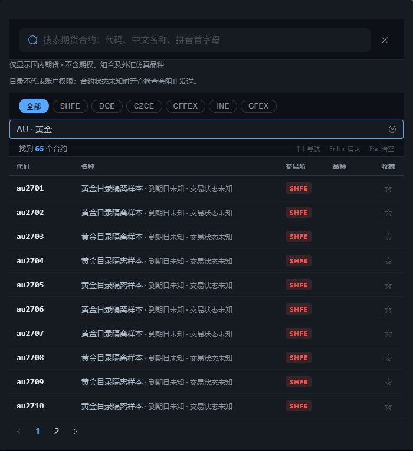
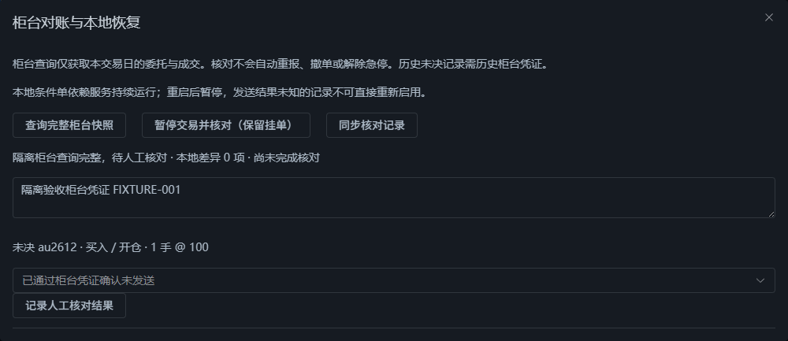

# 2026-10-19 隔离验证证据

全部样本均为隔离数据。没有创建联网 CTP API、发送真实报撤单或重启实盘服务。

| 检查 | 命令 / 环境 | 结果 |
|---|---|---|
| 后端 | Python 3.13 `.venv-live`；`QUANT_ENV=test`；`python -m pytest --basetemp=.test-artifacts/reliability-final` | 315 passed；见 backend.txt |
| Ruff | `python -m ruff check main.py server.py src tests` | 通过；见 ruff.txt |
| mypy | `python -m mypy` | 49 个文件通过；见 mypy.txt |
| 前端 | Node 24；`npm run quality` | ESLint、vue-tsc、38 项单测及生产构建通过；见 frontend.txt |
| 包体预算 | `node scripts/check_bundle.mjs` | 通过；见 bundle.txt |
| 浏览器 | `npm run e2e`；Edge/Chromium；独立后端 58000、前端 55173 | 28 passed；见 browser.txt |

新增回归包括资金过期、查询失败、出入金与跨日、合约生命周期、原生字段保留、完整查询/超时/错误请求、账户代次、人工确认、条件单重启与磁盘失败、保证金回报顺序、搜索响应乱序、目录分页及成交量增量窗口。此前静态/隔离探针曾复现四个原问题，新回归在修复后通过。

首次扩大回归时，旧原生夹具未模拟资金时效、旧提醒测试仍比较累计量、登录测试仍匹配旧标签；已按新的真实回调与交互语义更新。未降低生产门禁来迎合夹具。

已有 Starlette/httpx 弃用提示及 Vite 大包提示仍存在；没有新增依赖，包体仍在项目预算内。本轮未完成目标柜台上的新对账接口验收、真实报撤单、连续跨日或故障恢复演练。

已目视核对隔离浏览器截图：

